# Conf Companion

A conference companion for PyCon US on Android and iOS, written in Python with [Flet](https://flet.dev).
**Not an official PSF app.**

It is a community project that shows the Flet and Python communities what a full mobile app in Python can be. The
[official PyCon US app](https://github.com/PyCon/pycon-us-mobile) is our functional reference and quality bar, but
this is not a 1:1 port: where its UX, accessibility or offline behaviour can improve, ours does.

## What the app does

- **Now, Schedule, My schedule, Map and More** are the five tabs. The app opens on Now, which shows what is on and
  your next session.
- **Your own plan:** save sessions, see where they overlap and get reminders.
- **Finding your way:** search across the conference, floor plans with room pins, and pages for speakers, sponsors,
  open spaces, sprints, job listings and the venue.
- **Offline from the first launch:** a snapshot of the public conference feed ships inside the app, and the app shows
  how fresh its data is.
- **One design:** Material 3, the same on both platforms, with light, dark and high-contrast schemes.
- **Accounts and staff tools:** sign-in, favourites sync, lead retrieval, door check, swag pickup and Code of Conduct
  capture run against [our local mock server](tools/mock_api/README.md), not PyCon's servers.

## Screenshots

Taken at a fixed moment of the 2026 conference (Friday, 11:04), so the schedule is live.

**Android** (release build on a Pixel 6a emulator)

| | Now | Schedule | A session | Floor plan | My schedule | More |
|---|---|---|---|---|---|---|
| Light | 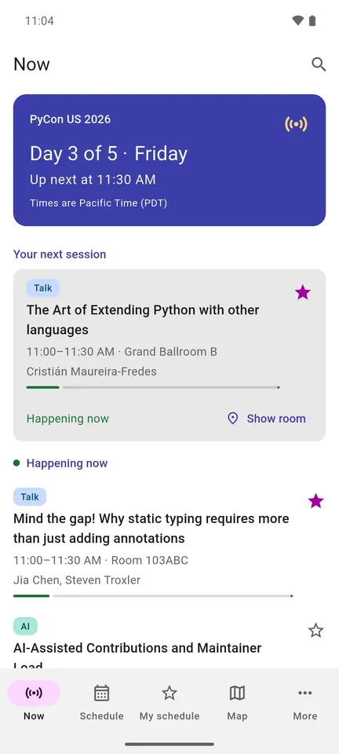 | 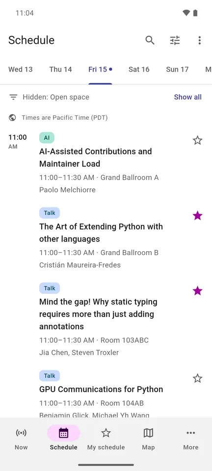 | 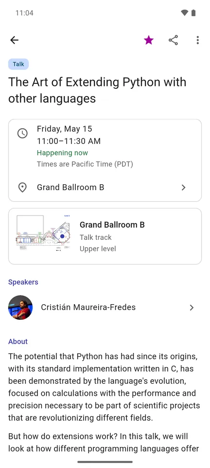 | 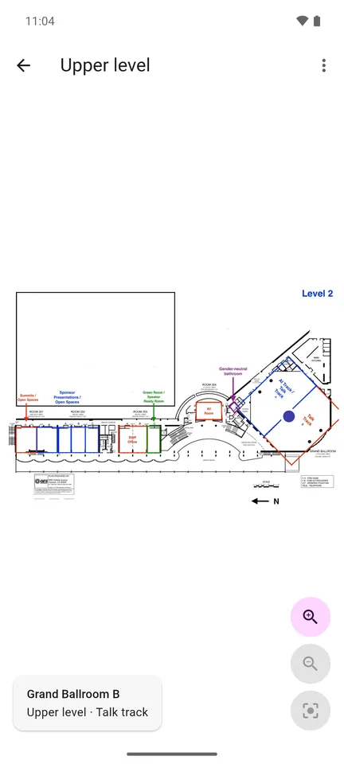 | 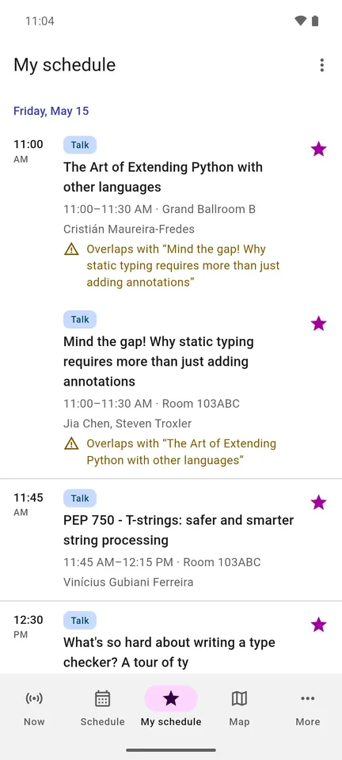 | 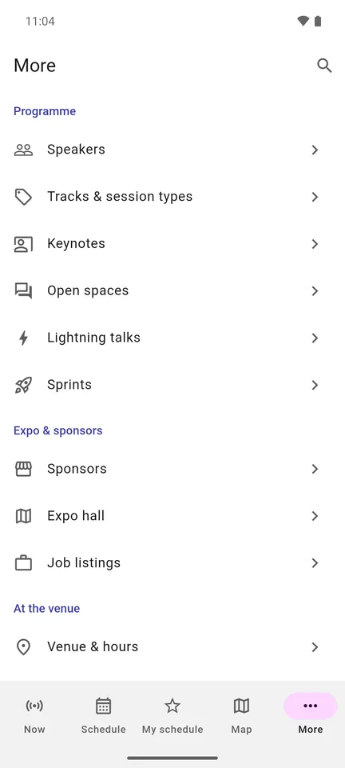 |
| Dark | 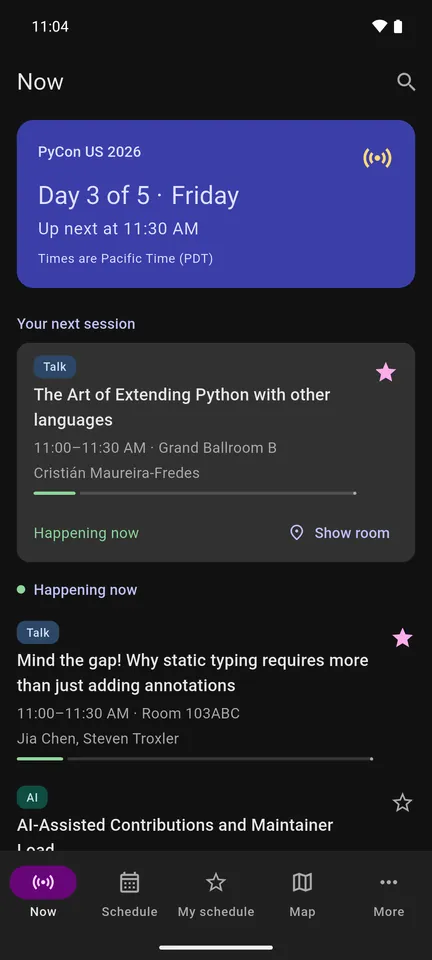 | 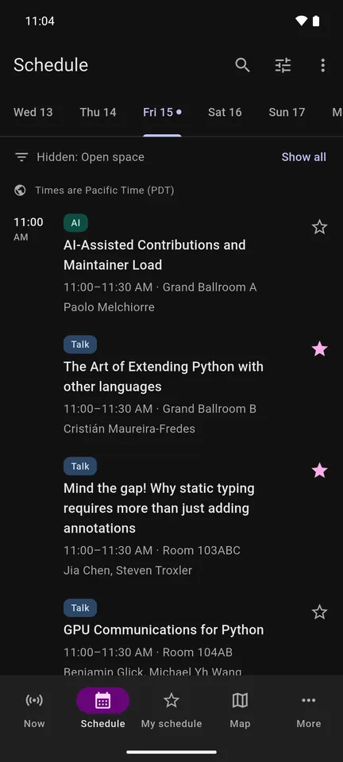 | 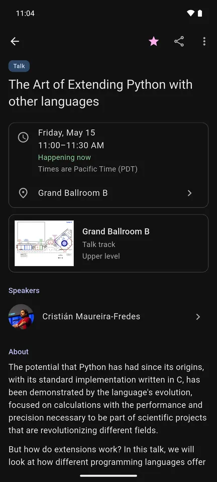 | 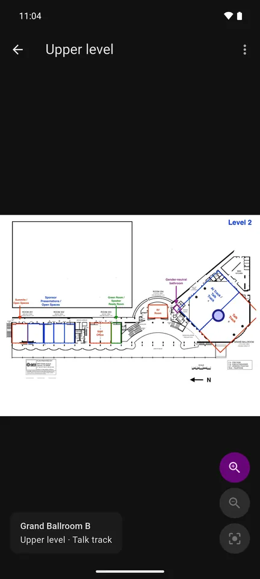 | 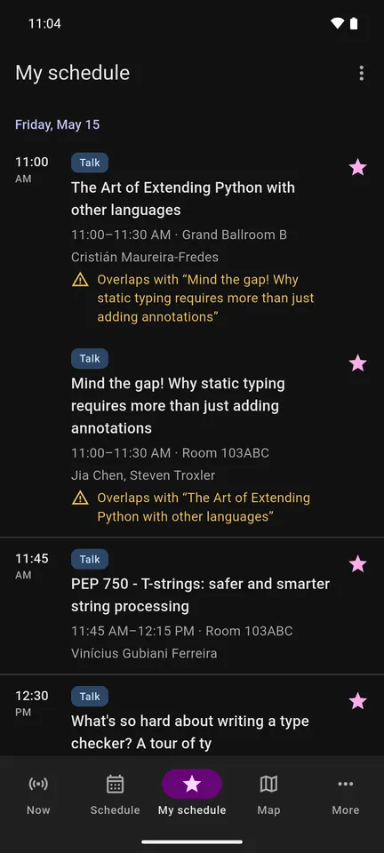 | 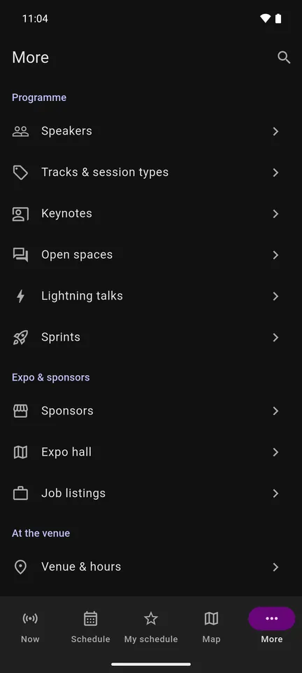 |

**iOS** (iPhone 17 simulator)

| | Now | Schedule | A session | Floor plan | My schedule | More |
|---|---|---|---|---|---|---|
| Light | 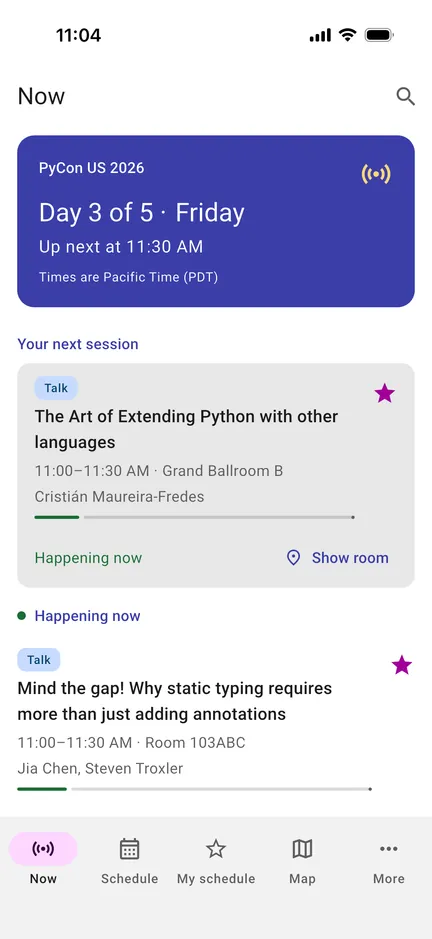 | 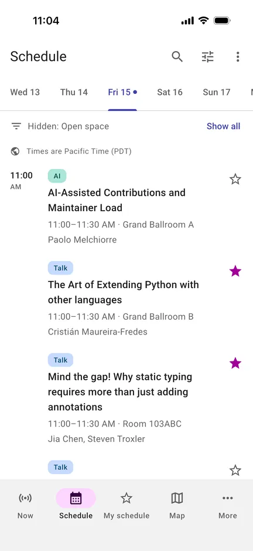 | 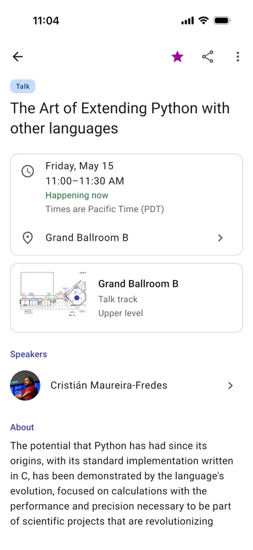 | 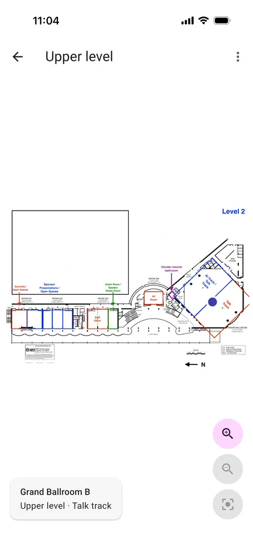 | 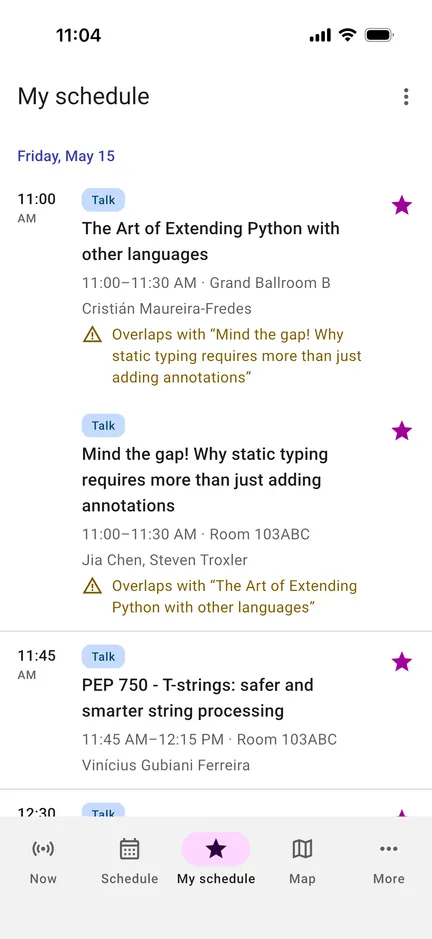 | 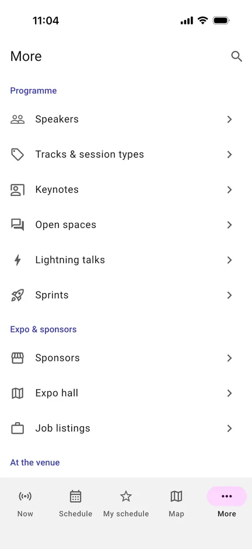 |
| Dark | 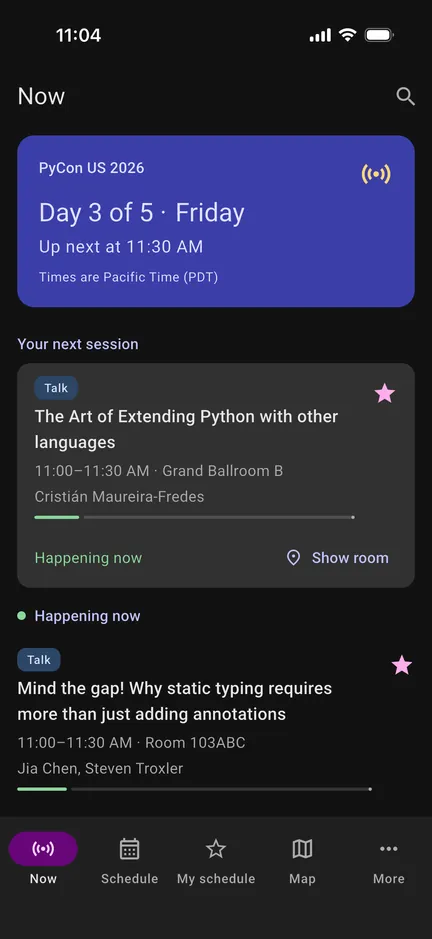 | 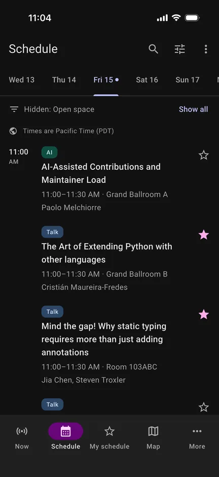 | 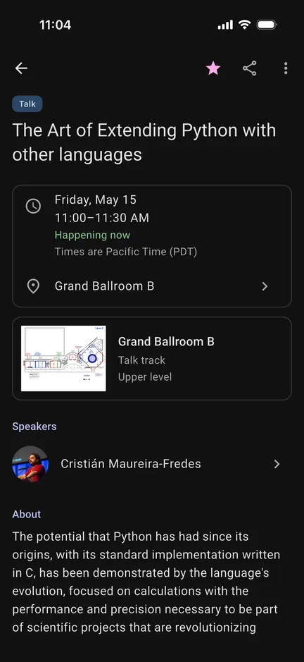 | 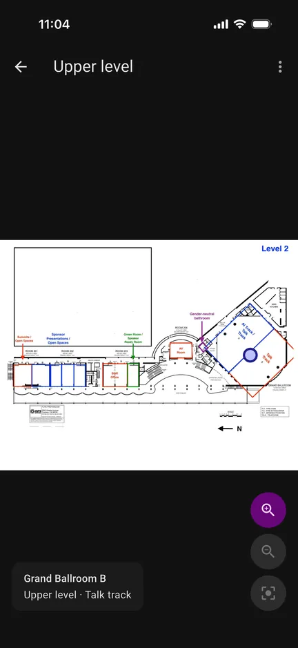 | 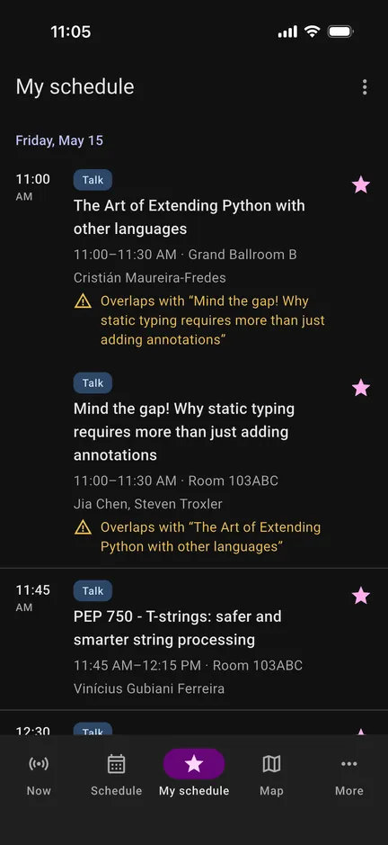 | 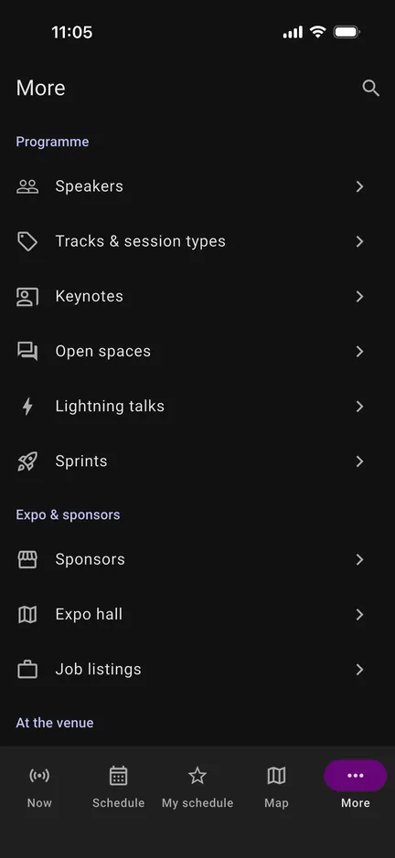 |

## Status

The app is under active development and has no public builds. To try it, build it from source. It carries the 2026
conference data until the 2027 feed is published.

- **The attendee features are built:** schedule, My schedule, search, maps, venue pages, reminders and offline use.
  What remains is mostly checking them on real devices.
- **Accounts and staff tools are built against the mock server.** The scanner's camera preview waits on a
  barcode-scanner extension for Flet; until then, badge codes are typed in.
- **The last phase, P4 Showcase, is what comes next:** the performance pass, the accessibility audit, a View source
  action on each screen, the 2027 data and the licence and trademark review. The repository is private for now, and
  making it public is part of this phase.

The objective is to present the app at PyCon US 2027. GitHub issues hold the live task list;
[`docs/roadmap.md`](docs/roadmap.md) describes the phases.

## What it isn't

- **It is not an official app.** The Python Software Foundation (PSF) and the PyCon US organisers don't make or endorse
  it. For the official app, see the link above.
- **It doesn't talk to the PSF's private API.** Conference data comes from the public feed. Everything that would need
  the private API uses the mock server instead, so real PyCon accounts don't work here.
- **It is for phones and tablets only.** There are no web or desktop versions, and a desktop window is only a
  convenience for development.

## Why Flet

Flet lets you write a mobile interface in Python: Flutter draws the screen, and the Python runtime ships inside the
app. That gives one codebase for both platforms, in a language many developers at PyCon can read and change.

The app is also a test of Flet. When it needs something Flet lacks, we ship a documented interim and record the gap in
[`docs/flet-gaps-and-extensions.md`](docs/flet-gaps-and-extensions.md). The project's owner maintains Flet.

## How it's built

- **Python 3.14 and Flet 1.1.0.dev4.** Every Flet package comes from PyPI at that one exact version, a prerelease until
  Flet 1.1.0 is out; `pyproject.toml` pins it. `flet build` packs the Python runtime into the Android and iOS apps.
- **Declarative UI.** Each screen is an `@ft.component` module in `src/pycon_us/screens/`, shared widgets live in
  `ui/`, state is held in `@ft.observable` stores, and `ft.Router` handles navigation.
- **A pure core.** `core/` holds the feed, models, queries and time handling, and never imports Flet, so it is tested
  without a UI. `services/` holds what touches the outside: storage, the feed fetch, notifications.
- **Data.** The app ships a snapshot of the public `conference.json` feed, plus our own TOML files for the venue pages
  and floor-plan pins (`src/pycon_us/data/<year>/`). It refreshes from the public feed and works offline.
- **Tests.** Thousands of pytest tests need no device; the device journeys run with [Maestro](https://maestro.dev) on an
  emulator and a simulator.

[`docs/architecture.md`](docs/architecture.md) goes through each part.

## Accessibility

These rules apply to every screen, and every UI change goes through the
[checklist in `docs/ux.md`](docs/ux.md#9-accessibility-checklist-every-ui-pr-d-33-d-93):

- **Screen readers:** controls have a name, role and state, a row reads as one phrase with its star as a separate stop,
  and headings have levels.
- **Touch:** targets are at least 48 dp, and gestures have a button alternative, such as the zoom buttons on maps, a
  list view of the expo hall and typed badge codes.
- **Contrast:** AA in the light and dark schemes, and 7:1 for text in high contrast, which follows the OS or a switch in
  Settings. Tests check the colour pairs the theme declares.
- **Large text:** layouts are built to reflow at 200 % text size, without fixed heights around text.
- **Motion:** the app honours the OS's reduced-motion setting.
- **Colour:** it is never the only signal; badges have text, and outcomes have an icon and a word.

Every screen has been audited on an Android emulator with TalkBack's output read by a machine, at 200 % text and in the
four colour schemes, and on an iOS simulator at the largest text: the results and what they leave out are in
[`docs/testing-and-quality.md`](docs/testing-and-quality.md#74-the-p4-audits-results-837). No person has listened to it
yet, and VoiceOver needs a real iPhone, so those checks are still to come. Limits that come from Flet are listed in
[`docs/flet-gaps-and-extensions.md`](docs/flet-gaps-and-extensions.md).

## Running it

You need git and [uv](https://docs.astral.sh/uv/). Android also needs an emulator or a phone, and iOS needs a Mac with
Xcode. While the repository is private, cloning it needs access to it.

```bash
gh repo clone ndonkoHenri/pycon-us-flet && cd pycon-us-flet
uv sync --locked
uv run pytest
uv run flet devices
uv run flet debug android -d <device>
```

- `uv sync` installs Python 3.14 and every package, Flet included; `gh` is one way to clone, any git login with access
  works too.
- `pytest` needs no device.
- `flet devices` lists your emulators, simulators and phones. For iOS, run
  `LANG=en_US.UTF-8 uv run flet debug ios -d <simulator>` instead of the last line.

The first `flet debug` installs Flutter and the Android SDK for you, and the first build takes several minutes.
[`docs/development.md`, section 5.1](docs/development.md#51-from-a-clean-mac) covers creating an emulator, the iOS
setup and how long each step takes.

## Contributing and docs

- [`CONTRIBUTING.md`](CONTRIBUTING.md): how to set up, find an issue and send a PR.
- [`AGENTS.md`](AGENTS.md): how we work, for people and automated coding assistants: issues, branches, reviews and the definition of done.
- [`PLAN.md`](PLAN.md): the vision, scope, phases and risks.
- [`CODE_OF_CONDUCT.md`](CODE_OF_CONDUCT.md) and [`SECURITY.md`](SECURITY.md): how we treat each other, and how to
  report a vulnerability privately.

| Doc | What it holds |
|---|---|
| [`docs/ux.md`](docs/ux.md) | The UX and UI spec: navigation, design system, every screen, accessibility |
| [`docs/architecture.md`](docs/architecture.md) | Modules, routing, state, the data pipeline, the mock API |
| [`docs/flet-gaps-and-extensions.md`](docs/flet-gaps-and-extensions.md) | What Flet lacks, the interim we ship, and the upstream work |
| [`docs/development.md`](docs/development.md) | Toolchain and Flet pin, dev loop, mock server, builds, checks, signing |
| [`docs/testing-and-quality.md`](docs/testing-and-quality.md) | Test strategy, UI flows, device checklist, performance |
| [`docs/roadmap.md`](docs/roadmap.md) | The phases broken into epics and issues |
| [`docs/demo-script.md`](docs/demo-script.md) | The stage demo, a draft: its beats, timings and fallbacks, with no Wi-Fi |
| [`docs/feature-matrix.md`](docs/feature-matrix.md) | Every feature of the official app, plus ours: what we do with it, and in which phase |
| [`docs/decisions.md`](docs/decisions.md) | The binding decisions, each with a number, and verified Flet facts. It is large, so search it by number |
| [`docs/spikes/`](docs/spikes/) | The verdicts of our technical spikes |
| [`docs/research/`](docs/research/) | The frozen analysis of the official app and of Flet's capabilities |

## Licence

[Apache-2.0](LICENSE), the same as the official app. [`NOTICE`](NOTICE) credits that app and lists the third-party
assets we use.

"PyCon" and "Python" are trademarks of the Python Software Foundation, and the licence grants no rights to them. We use
the names only to say which event and language this is about; the app's name and icon use no PSF mark.
