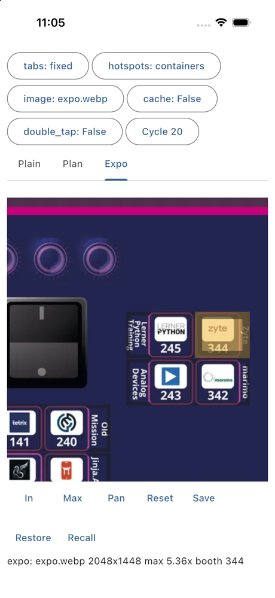

# S7: Do real floor plans with about 60 hotspots work in `InteractiveViewer` on a low-RAM phone?

**Spike:** S7, `P2-01` ([#361](https://github.com/ndonkoHenri/pycon-us-flet/issues/361), PLAN §8; opens P2-E1). **Date:** 2026-10-21, about 2 hours of builds and runs on one Mac.
**Decides:** D-312 (plan images, the viewer's maximum zoom, the hotspot approach, Map without a swipeable `TabBarView`, how a pane keeps its zoom; amends ux.md §5.8, §6.1, §6.2). **Fact:** F130. **Upstream:** U110 ([#560](https://github.com/ndonkoHenri/pycon-us-flet/issues/560), `TabBarView.physics`). **Open gate:** the low-RAM Android run (below, "Not covered"): until it is recorded, the low-RAM half of the question has no answer; the iPhone release-build memory stays with [#121](https://github.com/ndonkoHenri/pycon-us-flet/issues/121).

## Question

Do the 2026 plans, re-encoded to 2048 px or less, with the expo's 61 booths as hit areas in an `InteractiveViewer`, stay usable and within memory on a low-RAM phone? Which image format and hotspot approach do the floor viewer (§6.1) and the expo map (§6.2) use; does a `TabBarView` pane steal the plan's pans; and can a pane keep its zoom (D-18)?

## Answer: yes on iOS, with WebP at 2048 px, one `Container` per booth, and no swipeable `TabBarView`; on a low-RAM Android phone, inconclusive

**Low-RAM Android is not answered.** Android never ran the experiment ("Not covered"): no memory, no repeated mounting, no frame times and no TalkBack pass were measured there, and the iOS simulator's footprint and the decoded-image arithmetic cannot stand in for them. So the choices below (format, size, hotspots, tabs, zoom memory) rest on iOS, where they hold; whether the expo map stays usable and within memory on a 2 GB Android phone stays an **open gate**: the run on `pycon_lowram_api34` (PLAN §8) is recorded here, on a quiet host, before the expo map (§6.2) ships. If it fails, the Fallback below applies.

- **Images (D-312):** every plan is re-encoded by [`07-floor-plans/reencode.py`](07-floor-plans/reencode.py) to 2048 px on its longer side, as **lossy WebP, quality 80**: 110–200 KB a plan, a third of JPEG q85 (330–540 KB) and a seventh of PNG, with no loss visible at maximum zoom. The format changes the download, not the memory: every 2048-px plan decodes to the same 11.3–12.6 MB of RGBA. `Image.cache_width` is not used: it would decode the plan at screen width and lose the detail the zoom exists for, to save about 8 MB on the one plan on screen.
- **Memory (iOS 26.5 simulator, debug build):** the app's footprint is about 258 MB on a plain list, **266–270 MB** with the expo plan and its 61 booths, at 1x, at the maximum zoom and after panning, with a **peak of 281–302 MB** while the plan decodes. The 4966-px source plan peaks at **347 MB**: re-encoding saves about 50 MB of decode peak. Android's numbers on the 2 GB AVD were not taken (the host was swapping; "Not covered").
- **Maximum zoom:** `max_scale = natural width / displayed width`, so one image pixel at most fills one logical pixel: **5.36x** for the 2048-px expo plan on the iPhone 17 (382 dp wide), where booth names and numbers read cleanly (the screenshot below); the 4966-px source would allow 13x and show nothing more that matters.
- **Hotspots (D-312):** one `Container` per booth inside `Semantics(content=..., button=True, label=..., identifier=...)`. Flutter hit-tests them, they give a screen reader 61 named buttons, and every tap landed on the right booth at 1x and at 5.36x. One `GestureDetector` hit-tested in Python was as accurate (0.02–0.10 ms a test) and no faster to build (render of the pane 47–75 ms with containers, 78 ms with one detector, on a host under load), but it gives a screen reader nothing: it loses.
- **No double-tap on the expo map:** a `GestureDetector(on_double_tap=...)` around the viewer delays **every** single tap by Flutter's double-tap timeout: tap down to tap was **326 ms** with it and **5–30 ms** without. The zoom buttons are the single-pointer path (WCAG 2.5.1); double-tap stays only on plans with nothing to tap.
- **Pan versus swipe:** a `TabBarView` pane **steals** horizontal pans. At 5.36x, a finger-speed horizontal drag (2.5 s) on the Concourse plan changed the tab instead of panning it, as it did at 1x. So the Map uses `Tabs` with a `TabBar` and **no** `TabBarView` (only the selected pane is built), and **U110** asks for `TabBarView.physics`: the only stop at the pin, `disabled`, disables every booth inside the pane too (F130).
- **Zoom across a tab switch (D-18):** a pane that leaves loses its zoom (scale 1.0 on return), and `save_state()`/`restore_state()` cannot bring it back: the saved matrix lives in the widget state that left with the pane (F130). The last `on_transform_changed` values, kept in `ViewMemory`, can: `reset()`, `zoom(scale)`, `pan(x / scale, y / scale)` put the pane back exactly (**5.361, (−321.7, −214.5)**). D-18's remembered zoom stands, with that interim until U3 (§5.7). The panes must be **keyed**: unkeyed, Plan and Expo in the one slot are the same component to Flet, which migrates one into the other with its hook state and its viewer (the first run's Concourse pane showed the Expo's selected booth); the numbers here are from the keyed rerun.

## Method

- **Host:** Apple M4 (24 GB), macOS 27.0, Xcode 27.1, Android emulator 37.2.12.0, uv 0.12.15. **Other agents' builds and seven emulators ran at the same time:** load average 290–910 and 34 GB of swap in use, so every timing here is a relative signal at best, and Android could not be measured (below).
- **Flet:** the pin `15854a0ac` (`.flet-ref`), Flutter 3.47.7. Images with Pillow 12.0.0.
- **Devices:**
  - iOS: my own "361-iphone17" (iPhone 17, iOS 26.5, 23F77), a debug build (`flet build ios-simulator`, D-102), deleted at the end. Taps and drags through the free local Maestro CLI; memory from the host with `footprint <pid>` (`phys_footprint` and its peak); the app's lines from the simulator's unified log.
  - Android: a new AVD **`pycon_lowram_api34`** (Pixel 6a profile with a 720 x 1600, 280 dpi screen, Android 14 Google APIs arm64, `hw.ramSize` 2048 MB). The emulator raises any API 34 image to **2560 MB** ("Increasing RAM size to 2560MB", with or without `-memory 2048`), so 2.5 GB is the smallest this image runs with. `pycon_pixel6a_api36` (D-107) no longer existed on the Mac and was recreated as D-107 describes (4 GB) for the comparison; it was not booted.
- **Reproducer:** [`07-floor-plans/`](07-floor-plans/), its own `pyproject.toml` on `.flet-src`.
  - `reencode.py`: the re-encode, kept for next year (the command is in its docstring and in `pyproject.toml`). It writes the WebP and, for comparison, a JPEG of each plan, and the expo's 4966-px source, into `src/assets/plans/` (git-ignored: the plans stay PyCon's, D-87).
  - `src/booths.json`: the 61 booths of `excluded/pycon-us-mobile/src/app/expo-hall-map/` as ratios of the plan (the Ionic file gives them in a 9931 x 7021 space).
  - `src/main.py`: three tabs (Plain, Plan with the Concourse plan, Expo with the booths) and a toolbar that switches `TabBarView` or a lone pane, containers or one detector, the image, `cache_width` and a double-tap detector. The viewer's buttons zoom, pan, reset and try the three ways back to a zoom. Every event prints an `S7` line.
  - `drive_ios.py` and `drive_android.py`: the steps the runs used (taps, drags, memory, frame intervals, tap accuracy from the booth nodes' bounds).

## Evidence

### Images

`reencode.py` on the seven 2026 plans (Lanczos down to 2048 px; JPEG with 4:4:4; WebP method 6):

| Plan | Source | Fitted | Decoded | JPEG 70 | JPEG 85 | JPEG 92 | PNG | **WebP 80** | WebP lossless |
|---|---|---|---|---|---|---|---|---|---|
| Concourse (`floor-plan-1`) | 2200 x 1700 | 2048 x 1583 | 12.4 MB | 325 KB | 419 KB | 523 KB | 1150 KB | **164 KB** | 704 KB |
| Upper (`floor-plan-2`) | 2200 x 1700 | 2048 x 1583 | 12.4 MB | 256 KB | 320 KB | 391 KB | 786 KB | **109 KB** | 480 KB |
| Arena (`floor-plan-3`) | 1700 x 2200 | 1583 x 2048 | 12.4 MB | 356 KB | 468 KB | 596 KB | 1452 KB | **198 KB** | 920 KB |
| Seaside (`floor-plan-4`) | 2200 x 1700 | 2048 x 1583 | 12.4 MB | 311 KB | 395 KB | 491 KB | 974 KB | **135 KB** | 589 KB |
| Campus (`campus-map`) | 2200 x 1700 | 2048 x 1583 | 12.4 MB | 371 KB | 500 KB | 643 KB | 1595 KB | **170 KB** | 1154 KB |
| Job fair (`job-fair`) | 1700 x 2164 | 1609 x 2048 | 12.6 MB | 342 KB | 473 KB | 619 KB | 1460 KB | **152 KB** | 1122 KB |
| Expo (`pycon-us-2026-floorplan-nologo`) | 4966 x 3511 | 2048 x 1448 | 11.3 MB | 383 KB | 525 KB | 685 KB | 1408 KB | **178 KB** | 1093 KB |

- **Legibility at maximum zoom** (one image pixel to one logical pixel, scaled to the screen's 3x): booth 245's "Lerner Python Training", its logo and its number, and the Concourse plan's "ELEV." and room letter read the same in JPEG 70, JPEG 85, WebP 80 and PNG. WebP decoded and drew on iOS (the screenshot is the WebP).
- **Origins and marks, for `NOTICE` (D-87) and D-36:** all seven files are the Ionic app's (`src/assets/img/floor-plans/*.jpg` and `src/assets/img/pycon-us-2026-floorplan-nologo.jpg`, Apache-2.0). The four level plans are the venue's drawings with GES's title block ("Plan prepared by GES") and no PyCon or PSF mark. **Three carry PyCon marks:** the campus map (the "PyCon US 2026" wordmark at the top left, and the Long Beach CVB logo), the job fair plan (the PyCon US 2026 logo across the top) and the expo plan (the PyCon sun-and-palms mark at the top left, despite the file's "nologo"). The expo plan also bakes in sponsors' logos at their booths.

### Memory, iOS simulator (debug build, `phys_footprint`)

| State | Footprint | Peak |
|---|---|---|
| Plain list (after the first frame) | 258 MB | 262 MB |
| Expo, WebP 2048 px, 61 booths (first build: each booth drew an error box, F130), 1x | 266–268 MB | 295–302 MB |
| …at 5.36x | 270 MB | 295 MB |
| …after 8 drags at 5.36x | 266 MB | 295 MB |
| Expo, containers build (F130 fixed), 1x / 5.36x / after 8 drags | 259 / 254 / 265 MB | 281 / 281 / 302 MB |
| Expo, the 4966-px source JPEG (fresh start), 1x and 13x | 270 MB | **347 MB** |

A debug build runs Dart in JIT mode, so the absolute numbers are a ceiling; the differences are what count: the plan and its booths add about 10 MB in steady state and about 40 MB while decoding at 2048 px, against about 90 MB for the source plan.

### Taps

| Mode | Zoom | Taps | Right | Notes |
|---|---|---|---|---|
| Containers in `Semantics` | 1x | 245, 639 | 2 / 2 | Flutter's hit test |
| Containers in `Semantics` | 5.36x, panned | 245, 344 | 2 / 2 | the screenshot above |
| One `GestureDetector`, Python hit test | 1x | 245, 639 | 2 / 2 | local positions (160, 38) and (311, 58) on a 382 x 270 plan |
| One `GestureDetector`, Python hit test | 5.36x, panned | 245, 344, 243 | 3 / 3 | positions exact to 0.1 dp of the plan; two first aims at the booths' edges missed by 0.1 dp and were aimed again |

- At 1x a booth is about **18 x 12 dp** on a 382-dp plan (booth 245: 0.048 x 0.047 of the plan), below the 24-dp minimum target (WCAG 2.5.8) and far below 48 dp: a finger at 1x cannot be sure of a booth. The List (§6.2) and the zoom are the way to a booth; the map at 1x is for finding the area.
- **Double-tap delay**, one detector with `on_tap_down` and `on_tap`: tap down to tap 14–30 ms (5 ms once) without a double-tap detector, **326 ms** with one around the viewer.

### Pan versus swipe, and zoom across a tab switch

| Case | Result |
|---|---|
| `TabBarView`, Plan at 5.36x, drag right to left over 2.5 s | **tab changed** (Plan → Expo), the plan did not move |
| `TabBarView`, Expo at 1x, drag left to right over 2.5 s | tab changed (Expo → Plan) |
| `TabBarView`, Expo at 5.36x, drag over 0.4 s | the plan panned (x −228); Maestro's fast drag moves past the viewer's 36-dp pan slop in its first events, which a finger does not |
| Lone pane under a `TabBar`, 5.36x, drags in four directions | panned every way; no tab change possible |
| Keyed panes (`key="plan"`, `key="expo"`): booth 245 selected on Expo, then Plan | Plan mounts afresh (its `mounted` line) and shows no booth; unkeyed, the first run's Plan showed "booth 245" |
| Plan at 5.36x, panned to (−321.7, −214.5), `save_state()`, away to Expo and back | Plan mounts afresh |
| …`restore_state()` | **scale 1.0, (0, 0)**: the pane's state, and the saved matrix, left with it |
| …the last `on_transform_changed` (5.361, −321.7, −214.5), then `reset()`, `zoom(5.361)`, `pan(−321.7 / 5.361, −214.5 / 5.361)` | **scale 5.361, (−321.7, −214.5)**, exact |

- **Why the pages win:** the `PageView` under `TabBarView` accepts a horizontal drag after 18 dp (`kTouchSlop`); the viewer's scale recognizer after 36 dp of focal movement (`kPanSlop`, Flutter `gestures/scale.dart:746-752`, `constants.dart:65,76`). A finger crosses 18 dp first, so the page takes the drag at every zoom; only a synthetic drag that jumps past 36 dp in one event reaches the viewer first.
- **No `physics` at the pin:** Flet's `TabBarView` sets `physics: control.disabled ? NeverScrollableScrollPhysics() : null` (`DART/controls/tabs.dart:175-176`), and `disabled` is inherited by every descendant (`DART/models/control.dart:82-83`), so it would disable the booths too (F130, U110).

## Not covered

- **Android on the 2 GB AVD.** The release APK built (60 MB, arm64) and the AVD booted once, but the host was swapping 34 of 35 GB with seven emulators running: the install failed twice (`Can't find service: package`, then the system server restarting) and the emulator's CPU threads hung for 17–20 s at a time, so **no `dumpsys meminfo`, no 20 open/close cycles, no SurfaceFlinger frame intervals and no TalkBack pass** were taken on Android, and the time box ran out. The reproducer and `drive_android.py` (`launch`, `mem`, `pans`, `frames`, `booths`, `tapall`, `tapsame`) are ready for a rerun on `pycon_lowram_api34` against `pycon_pixel6a_api36` on a quiet host (`pans` now drags between points inside the plan's on-screen bounds and reports how many transforms the app logged, so `frames` measures real pans; the first version's swipes started at x=800 on the 720-px AVD). The decoded sizes suggest about 12 MB of image (16 MB with mipmaps) on top of the app, but that is arithmetic, not a measurement: it does not answer the question, which stays open (the gate in the Answer).
- **TalkBack over the 61 booth nodes** (order and time): not run (Android). Flutter orders semantics nodes by position, so the order is expected top to bottom, then left to right, which is not booth-number order; the Map's List is the screen reader's way to a booth either way (§6.2: List first when `accessible_navigation`). The build issue checks the order with TalkBack.
- **20 open/close cycles on iOS:** the Maestro CLI crashed before the cycle button was tapped; not measured.
- **Frame times:** no usable numbers on this host (load 290–910). Panning at 5.36x on the simulator looked smooth in the screenshots taken, which says little.
- **Release-build memory on the iPhone:** #121 (D-102), with the expo plan at 1x and 5.36x and after 20 cycles.

## Decisions changed

- **D-312** (amends ux.md §5.8, §6.1, §6.2; keeps D-18): plans as 2048-px WebP q80 from `reencode.py`, no `cache_width`; `max_scale = natural / displayed`; booths as `Container`s in `Semantics(content=...)`; no double-tap where something on the plan is tappable; Map panes under a `TabBar` without a `TabBarView`; a pane's zoom kept in `ViewMemory` and put back with `reset`, `zoom`, `pan`.
- **F130:** `ft.Semantics(x)` puts `x` in `tooltip`; `TabBarView` can only stop swiping by disabling its pages; a pane's `InteractiveViewer` state (and `save_state`'s matrix) does not survive the pane leaving.
- **U110** ([#560](https://github.com/ndonkoHenri/pycon-us-flet/issues/560)): `TabBarView.physics` (`docs/flet-gaps-and-extensions.md` §1.3).

## What the map issues must apply

- **Plans (DATA-32, MAP-07):** run `reencode.py` on each year's plans and bundle the `.webp` files; crop or cover the PyCon marks on the campus, job fair and expo plans before they ship (D-36), and credit the plans in `NOTICE` (D-87) in the same PR.
- **Floor viewer (§6.1) and expo map (§6.2):** `InteractiveViewer(min_scale=1, max_scale=natural_width / displayed_width)` around a `Stack` sized from `on_size_change`; booths as positioned `Container`s, each `Semantics(content=..., button=True, label="Booth 613, Bloomberg", identifier=...)` with `content=` by name (F130); the selection drawn on the booth's own `Container`.
- **Map (§5.8):** `Tabs` with a `TabBar` and the selected pane alone under it, each pane keyed (F130); each pane's last `on_transform_changed` in `ViewMemory`, put back after the pane is laid out with `reset()`, `zoom(s)`, `pan(x / s, y / s)` (two or three frames show the steps; U3's `set_transform` removes them).
- **Before the expo map ships (the open gate):** the low-RAM Android run on `pycon_lowram_api34` (memory, 20 open/close cycles, frame intervals over real pans, TalkBack's order and the time to reach a booth), recorded in this file; the Fallback applies if it fails.

## Fallback

If a plan at 2048 px proves too heavy on a real low-RAM Android phone, drop the plans to 1600 px (about 7 MB decoded, still 4.2x zoom on a 382-dp plan) before reaching for `cache_width`; if 61 `Semantics` buttons prove slow for TalkBack, keep the containers for touch and mark them `exclude_from_semantics`, leaving the List as the screen reader's path.
